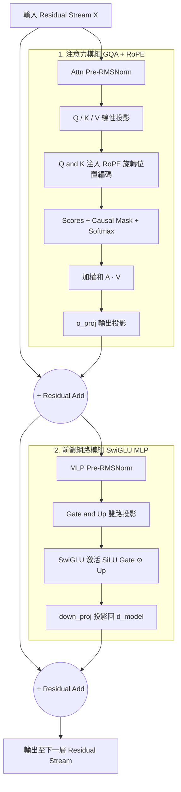

# Toy Llama Block Stepper

一個輕量、全前端的 **LLM Transformer Block 逐步計算可視化與互動工具**。

本專案將標準的 Llama/Mistral 架構（包含 GQA、RoPE、SwiGLU MLP 與 RMSNorm）拆解為極小的維度，讓你可以**手動逐步觀測**、**點擊查看向量與矩陣內積細節**，並**即時編輯輸入矩陣 $X_0$** 來觀察數值流轉。

---

## 🌟 特色

* **零套件建置**：純原生 HTML/CSS/JavaScript + MathJax，無需 `npm install`，直接在瀏覽器開啟或上載至 GitHub Pages。
* **特色模型切換**：內建「隨機基準模型」與「Previous-Token Head 機制模型」（示範關注前一個 Token 的注意力頭）。
* **完整算術展開**：點擊矩陣中任意格子，即可展開查看該格的逐項乘加算數細節 (Micro view)。
* **輸入與模型解耦**：模型架構與權重採獨立資產載入（支援純靜態載入），可隨時自由調整 `seq_len`、`seed` 或直接編輯 $X_0$ 矩陣，所有步驟即時連動重算。
* **動態圖表**：即時繪製各 position 的 Residual Stream 範數 $\|x_t\|$ 變化折線圖。
* **深淺色主題**：預設為淺色主題，支援手動 Toggle 🌓 切換深色模式。
* **完整鍵盤快捷鍵**：支援三維立體導航（`←`/`→` 步驟推進、`Ctrl+←/→` 極值跳轉、`↑`/`↓` 跨層同階段對照、`Q`/`W` 循環切換 Q head），並內建 `⌨️` 快捷鍵指南彈窗（按 `?` 隨時開關）。
* **雙側邊欄收合**：Header 提供 `⇤` 與 `⇥` 按鈕（快捷鍵 `[` 與 `]`），可隨時收合左側步驟清單或右側資訊欄，最大化主視圖空間。

---

## 📐 Transformer Block 算子架構圖

本工具模擬的單層 Transformer Block 運算流程如下：



---

## ⚙️ 模型規格與輸入設定

### 1. 模型規格（由模型決定，唯讀展示）
| 參數 | 預設值 | 說明 |
| :--- | :--- | :--- |
| `d_model` | `16` | 隱藏層向量維度（固定） |
| `L` | `4` | Transformer 層數（固定） |
| `Hq` | `4` | Query Heads 數量 |
| `Hkv` | `2` | Key/Value Heads 數量 (GQA 共享比例 `Hq/Hkv`) |
| `hd` | `4` | Head Dimension 向量維度 |
| `ffm` | `3` | MLP 隱藏層維度倍率 (`d_model * ffm`) |
| `theta` | `10000` | RoPE 的基底角頻率 $\Theta$ |

### 2. 輸入與推論設定（可於側邊欄互動調整）
| 參數 | 預設值 | 說明 |
| :--- | :--- | :--- |
| `T` (seq_len) | `5` | 序列長度（Token 數，支援 3~8） |
| `seed` | `7` | 輸入矩陣 $X_0$ 生成種子 |

---

## 📁 專案目錄結構

```text
toy-llama-stepper/
├── index.html               # 語意化 HTML 骨架
├── css/
│   └── style.css            # UI 樣式
├── js/
│   ├── vendor/
│   │   └── tex-svg.min.js   # 第三方 MathJax 數學排版引擎
│   ├── state.js             # 集中狀態管理
│   ├── steps.js             # 步驟定義
│   ├── model.js             # 模型推論的數學計算
│   ├── view.js              # 視圖渲染
│   └── app.js               # 應用程式入口、事件監聽
├── models/
│   ├── models-static.js     # 預設純靜態模型權重
│   └── presets.js           # 動態模型生成腳本
├── resources/
│   ├── icon-dark.svg
│   ├── icon-light.svg
│   └── og-preview.png       # 超連結分享的預覽
└── scripts/
    └── build-static.js      # 靜態模型權重構建工具
```

---

## 🚀 快速開始與部署

### 1. 本地執行
無需安裝任何環境，複製專案並用瀏覽器開啟：
```bash
git clone https://github.com/JunliXiao/toy-llama-stepper.git
# 直接用瀏覽器開啟 index.html 即可
```
若要透過 `scripts/build-static.js` 生成權重的靜態檔案，則需安裝 node

### 2. GitHub Pages 部署
1. 將專案中的單頁檔案命名為 `index.html`。
2. 推送至 GitHub Repository。
3. 至 Repo 的 **Settings** -> **Pages** -> 選擇 `main` branch 根目錄 (`/root`) 保存即可上線！